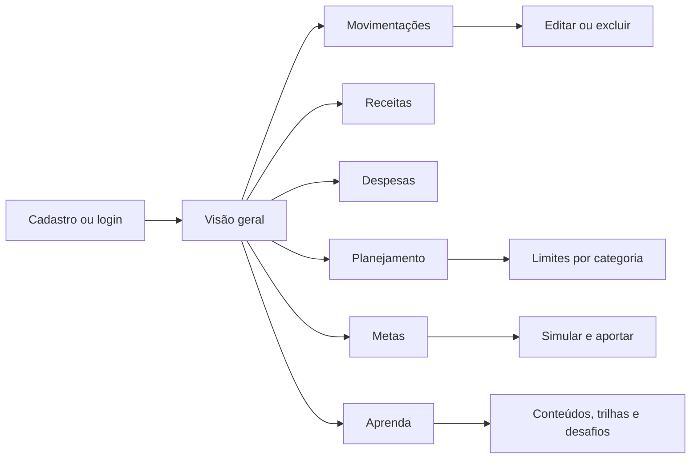

# Fluxos e wireframes do FINCONTROL

Este mapa orienta as telas em desktop e celular. Cada operação confirma o resultado no próprio contexto; erros não apagam os dados digitados.

## Navegação



No desktop, a marca e os dados da conta ficam na primeira linha; a navegação por seção ocupa a segunda. No celular, um cabeçalho compacto abre o mesmo menu. O título de cada página aparece dentro do conteúdo.

## Caminhos principais

| Objetivo | Passos | Retorno esperado |
| --- | --- | --- |
| Começar | Cadastro → validação → sessão → visão geral | Mensagem de sucesso e dados próprios |
| Voltar | Login → restauração da sessão | Página selecionada e dados atualizados |
| Recuperar acesso | Solicitar link → redefinir senha → login | Mensagem genérica no pedido; sessões antigas encerradas |
| Entender o mês | Selecionar período → saldo, receitas, despesas, insights e relatório | Valores coerentes para o mesmo período |
| Registrar gasto | Despesas → preencher → salvar | Formulário limpo, lista e resumo atualizados |
| Corrigir registro | Movimentações → filtrar → editar ou excluir | Confirmação e atualização imediata |
| Planejar | Planejamento → escolher categoria e mês → definir limite | Progresso e estado do limite visíveis |
| Criar objetivo | Metas → cadastrar → simular → aportar | Progresso e valor restante atualizados |
| Aprender | Aprenda → buscar tema → ler → quiz ou desafio | Progresso salvo na conta |

## Wireframes

### Acesso

```text
Desktop                              Celular
┌──────────────────┬───────────────┐  ┌───────────────┐
│ marca            │ título        │  │ marca         │
│ promessa clara   │ contexto      │  │ título        │
│ 01  02  03       │ campos        │  │ contexto      │
│ passos do produto│ ação principal│  │ campos        │
│                  │ troca de fluxo│  │ ação principal│
└──────────────────┴───────────────┘  └───────────────┘
```

Cadastro acrescenta nome, confirmação de senha e aceite; recuperação de senha usa uma tela curta. Erros aparecem junto ao campo e são anunciados por leitores de tela.

### Visão geral

```text
┌───────────────────────────────────────────────────────┐
│ marca / conta / sair                                  │
│ visão geral | movimentações | ...                     │
├───────────────────────────────────────────────────────┤
│ saudação                         mês  despesa  receita│
├───────────────────────────────┬───────────────────────┤
│ saldo disponível              │ entradas              │
│ valor em destaque             ├───────────────────────┤
│ contexto do saldo             │ saídas                │
├───────────────────────────────┴───────────────────────┤
│ insights                                               │
│ relatório: indicadores → gráficos → maiores gastos    │
└───────────────────────────────────────────────────────┘
```

No celular, todas as colunas viram uma coluna; ações ocupam a largura disponível. O período fica próximo dos indicadores que controla.

### Movimentações e registros

```text
┌───────────────────────────────────────────────────────┐
│ título e explicação                                   │
│ busca | tipo | categoria | datas | valores | ordenar  │
│ aplicar filtros                         limpar         │
├───────────────────────────────────────────────────────┤
│ data / categoria     descrição       valor   ações    │
│ ...                                                   │
│ anterior              página             próxima      │
└───────────────────────────────────────────────────────┘
```

Receitas e despesas usam formulário simples acima do histórico correspondente. Edição abre diálogo com dados preenchidos; exclusão pede confirmação com descrição e valor do registro.

### Planejamento, metas e educação

```text
┌───────────────────────────────────────────────────────┐
│ título + período ou resumo                            │
│ indicadores                                           │
├──────────────────────────────┬────────────────────────┤
│ lista/progresso              │ formulário/contexto    │
│ estados e ações              │ ação principal         │
└──────────────────────────────┴────────────────────────┘
```

Em telas estreitas, o formulário vem após a lista. A área Aprenda começa por catálogo pesquisável, segue para leitura curta e mostra progresso sem competir com os números financeiros.

## Estados de interface

| Estado | Tratamento |
| --- | --- |
| Carregando | Texto de estado e área reservada sem saltos bruscos de layout |
| Vazio | Explicação breve e ação para criar o primeiro registro |
| Erro de campo | Mensagem específica próxima ao campo, foco no primeiro erro |
| Erro de rede | Mensagem recuperável com opção de tentar novamente |
| Sucesso | Confirmação discreta e dados atualizados na tela |
| Sem permissão ou sessão expirada | Retorno ao login sem expor dados de outra conta |

## Critérios de revisão visual

- Ordem de tabulação acompanha a leitura; foco permanece visível.
- Texto e controles continuam utilizáveis em 320 px e com fonte ampliada.
- Cores de receita, despesa e estado não são a única forma de transmitir significado.
- Seleção de período e ações na mesma linha compartilham a linha de base dos controles.
